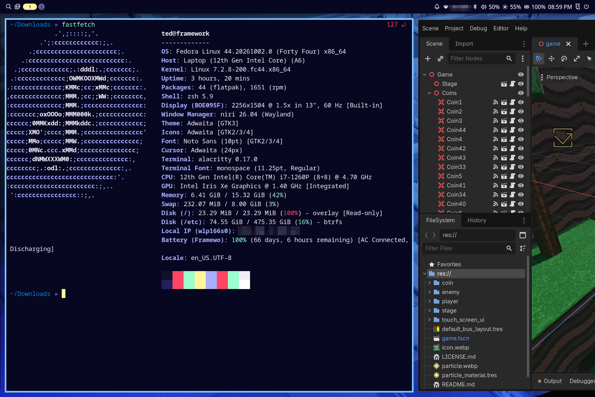

<p align="center">
  
</p>

A minimal [bootc](https://github.com/bootc-dev/bootc) desktop image: the [niri](https://github.com/YaLTeR/niri) scrollable-tiling compositor with [Noctalia](https://github.com/noctalia-dev/noctalia) as the shell, built on Universal Blue's [`base-main`](https://github.com/ublue-os/main) (Fedora Atomic with no desktop, plus ublue's codecs, kernel, udev rules and `ujust`).



## Status

Aerinite is in beta and built to be a minimalist OS for my personal laptop
(Framework 13).

## Philosophy

Aerinite is minimal: [niri](https://github.com/YaLTeR/niri) and [Noctalia](https://github.com/noctalia-dev/noctalia), and little else.

niri is a scrollable-tiling compositor. Windows sit in columns on an endless horizontal strip, so opening a new window never squeezes the ones you already have; you scroll to it instead. Noctalia is a complete desktop shell on top of it, covering the bar, notifications, launcher, lock screen, wallpaper and settings.

Aerinite aims to be unopinionated: it ships sensible defaults, everything can be overridden, and it avoids changes that break existing workflows wherever possible. The goal is a stable platform with minimal changes.

This isn't a new distro. It's just Fedora Atomic, where the whole system ships as
one read-only image. [Universal Blue](https://universal-blue.org) builds on that
image to add codecs and hardware support. Aerinite is a thin layer on top of
Universal Blue. Like other Universal Blue images, it stays out of your way:

- **Updates happen in the background.** New images are built automatically and downloaded quietly, then take effect on your next reboot. Each update is a complete, signed image applied in one step. If something goes wrong, the previous version is still in the boot menu.
- **Apps live in containers.** Desktop apps are Flatpaks from Flathub, and development tools run in Distrobox containers, so the base system stays small and untouched.

## What you get

- **Desktop**: niri + Noctalia (bar, notifications, launcher, lock screen, idle, wallpaper, polkit agent), Alacritty, Nautilus, imv
- **Login**: [Noctalia Greeter](https://github.com/noctalia-dev/noctalia-greeter), with niri preselected
- **Secrets**: [oo7](https://github.com/linux-credentials/oo7)
- **Shell**: zsh and fish are preinstalled alongside bash
- **Containers**: podman (+ compose); distrobox comes with base-main
- **Flatpaks**: Firefox, GNOME Text Editor and the [Bazaar](https://github.com/kolunmi/bazaar) app store, installed on first boot (uninstalling one opts out)
- **Hardware**: fingerprint for sudo, password prompts and the lock screen (not login), brightnessctl, playerctl, power-profiles-daemon
- **Fonts**: Cascadia, JetBrains Mono, Google Noto

Codecs come from base-main (negativo17 fedora-multimedia). The rpm Firefox and niri's recommended extras (waybar, swaylock, fuzzel) are not installed.

## Install

### Installer ISO

Sign in to GitHub and download the ISO from the latest [Build disk images](https://github.com/tedohayer/aerinite/actions/workflows/build-disk.yml) run. Unzip it, write it to a USB drive with [Fedora Media Writer](https://github.com/FedoraQt/MediaWriter) and boot from it. The installer works offline and sets up signed updates from `ghcr.io/tedohayer/aerinite:latest`.

### From an existing Fedora Atomic or Universal Blue system

Two things to know before switching:

- If you already have `~/.config/niri/config.kdl` (say, from another niri setup), niri uses it instead of Aerinite's, so Noctalia won't start. Move it aside, or start it with `include "/etc/niri/config.kdl"` and keep only your changes below that.
- On first boot, `flatpak preinstall` installs Firefox, Text Editor and Bazaar and removes Flatpaks your current image preinstalled that Aerinite doesn't list. Apps you installed yourself stay; reinstall any of the others you want from Bazaar.

Any Fedora Atomic desktop or Universal Blue image works as a starting point. Your current system doesn't have Aerinite's signing key yet, so the first switch can't verify the image:

```bash
sudo bootc switch ghcr.io/tedohayer/aerinite:latest
sudo reboot
```

Aerinite includes its key. Once you've booted into it, switch again with verification on:

```bash
sudo bootc switch --enforce-container-sigpolicy ghcr.io/tedohayer/aerinite:latest
```

From then on, every update is checked against the key before it's installed. Your system will only accept images built and signed by Aerinite's own build pipeline, so a tampered or substituted image is refused.

## Updating

Updates download in the background, are checked against Aerinite's signing key and take effect when you reboot. You have these ujust commands to control them:

- `ujust update`: update the system, Flatpaks and containers now
- `ujust update-schedule`: update daily, weekly or monthly
- `ujust toggle-updates`: turn automatic updates on or off
- `ujust toggle-update-notifications`: turn the "Update ready" notifications on or off
- `ujust update-firmware`: update device firmware

### Versions and tags

Builds are tagged `latest`, their Fedora major (`45`) and date (`45-20261015`), or `beta` for testing builds; switch between them with `sudo bootc switch --enforce-container-sigpolicy ghcr.io/tedohayer/aerinite:<tag>`.

## Configuration

The image ships defaults; anything in your home directory overrides them.

| What | Image default | Your overrides |
|---|---|---|
| niri | `/etc/niri/config.kdl` (from `system_files/etc/niri/config.kdl`), used when you have no config of your own | `~/.config/niri/config.kdl` starting with `include "/etc/niri/config.kdl"`, followed by your changes |
| Noctalia | `/usr/share/aerinite/noctalia.toml` (from `system_files/usr/share/aerinite/noctalia.toml`), linked into `~/.config/noctalia/00-image.toml` at login | `~/.config/noctalia/config.toml`. Changes made in Noctalia's settings window are saved to `~/.local/state/noctalia/settings.toml` |

To change the image itself, edit `build_files/build.sh` (packages and setup commands) or the config files under `system_files/` (laid out at their installed paths), and push to `main`.

## Verifying images

Images are signed with [cosign](https://github.com/sigstore/cosign). The public key is `cosign.pub` in this repo and `/etc/pki/containers/aerinite.pub` in the image:

```bash
cosign verify --key cosign.pub ghcr.io/tedohayer/aerinite:latest
```

## Building locally

```bash
just build          # builds localhost/aerinite:latest
just build-qcow2    # VM image via bootc-image-builder; user from disk_config/user.toml
just build-iso      # installer ISO
```

`just --list` shows everything else.

## Credits

Based on [fedora-atomic-niri](https://github.com/rgerardi/fedora-atomic-niri) and [ublue-os/image-template](https://github.com/ublue-os/image-template).
